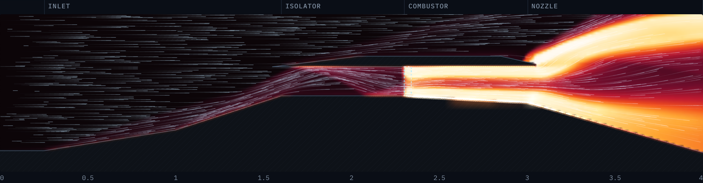
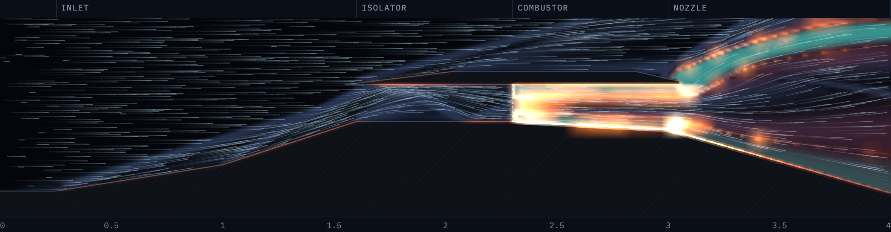

# Scramjet Flow Lab

An interactive 2D simulation of a **scramjet** (supersonic combustion ramjet) that runs in your browser. Air comes in at hypersonic speed, gets squeezed by shock waves, mixes with hydrogen and burns while still supersonic, then expands out of the nozzle to make thrust. Turbulent boundary layers, wall friction and wall heating are all simulated.

**▶ Live demo:** https://farvanyoshi.github.io/scramjet-sim/





## What a scramjet is

A jet engine needs compressed air to burn fuel in. A normal jet uses spinning compressor blades. A scramjet has **no moving parts**: it flies so fast (Mach 5+) that bending the air with angled walls compresses and heats it.

| Section | What happens |
|---|---|
| **Inlet** | Ramps turn the flow. Each turn makes an *oblique shock*: pressure and temperature jump, speed drops (Mach 6 → ~3.2 here). A turbulent boundary layer grows along the walls. |
| **Isolator** | Straight duct. Shocks bounce between the walls and interact with the boundary layers. It shields the inlet from pressure spikes in the combustor. |
| **Combustor** | Sonic hydrogen jets fire from wall slots. The fuel must mix with air by turbulence and only self-ignites where the air is hot enough. The flow stays **supersonic** while it burns: that is the "s" in scramjet. |
| **Nozzle** | The floor drops away so the hot gas expands and speeds up. Its pressure on the sloped wall is the thrust. Friction and wall heating work against it. |

## Using it

- **Flight Mach number** (3–10) and **fuel φ** (equivalence ratio: 1 = exactly enough H₂ to burn all the oxygen).
- **Views:** temperature, Mach, pressure, schlieren (shows shocks), turbulence (eddy viscosity), fuel & flame.
- **Flow model:** Turbulent RANS (default) or Inviscid Euler, so you can see what friction and heat loss cost.
- **Particles:** tracers that ride the flow. Glowing wall edges show where heat flows into the structure.
- Hover over the flow to read local values.

Things to try:
1. **Mach 4.5**: the air never gets hot enough for hydrogen to self-ignite, so the engine only makes drag.
2. **Inviscid vs Turbulent** at Mach 6: thrust roughly halves once friction and wall heating are on (about 3.3 → 1.6 kN/m).
3. **φ > 1**: thrust barely creeps up while the share of fuel burned falls below half (oxygen-limited), and the combustor exit approaches Mach 1.
4. **Mach 10**: everything burns, but friction drag (~3.8 kN/m) and the wall heat load (~8 MW/m) outweigh the thrust.

## Running locally

The page uses ES modules and a Web Worker, so serve it over HTTP (opening `index.html` as a file will not work):

```bash
git clone https://github.com/farvanyoshi/scramjet-sim.git
cd scramjet-sim
python3 -m http.server 8000
```

Then open http://localhost:8000.

Headless solver run with Node 18+ (prints thrust, drag, heat load, combustion efficiency as the flow develops):

```bash
node test/run.js 6 0.6 3000 320 turbulent   # mach, phi, steps, grid width, model
```

## Physics and numerics

**Equations.** 2D Reynolds-averaged Navier–Stokes, finite volume, with conserved variables `[ρ, ρu, ρv, E, ρν̃, ρZ, ρY]`. Here ν̃ is the Spalart–Allmaras turbulence variable, Z is the mixture fraction (all injected hydrogen), and Y is the unburnt hydrogen.

| Piece | Model |
|---|---|
| Shocks / convection | MUSCL reconstruction (van Leer limiter) + HLLC Riemann solver |
| Time stepping | 2-stage SSP Runge–Kutta, CFL 0.5 |
| Viscosity, conduction | Sutherland's law, Pr = 0.72, Pr_t = 0.9, real flight Reynolds number (~2×10⁶ per m) |
| Turbulence | Spalart–Allmaras one-equation RANS model, fully turbulent, with wall distance from the true geometry |
| Wall friction | Wall functions: Spalding's law of the wall with Eckert reference-temperature properties |
| Wall heat transfer | Reynolds analogy; walls cooled to 1,000 K (capped at the gas recovery temperature) |
| Gas | Thermally perfect air: N₂ and O₂ vibrational energy, so γ falls from 1.40 to ~1.29 at 3,000 K |
| Fuel injection | Sonic H₂ jets from slots in the combustor floor and cowl, metered from φ and the measured air capture |
| Mixing | Turbulent diffusion, Sc = 0.22, Sc_t = 0.7 |
| Chemistry | One-step 2H₂ + O₂ → 2H₂O, Arrhenius rate (T_a = 20,000 K), oxygen-limited, 120 MJ/kg, heat release tapered out at 2,600–2,900 K to stand in for dissociation |
| Walls on a square grid | Ghost-cell immersed boundary (mirror state at the image point across the real wall) |

**Checks.**
- The first-ramp shock angle matches oblique-shock theory (≈16.9° at Mach 6 over 9°).
- Skin friction on the first ramp is within ~11–17% of the Van Driest II turbulent flat-plate correlation.
- Ignition sets in between Mach 4.5 and 5.

### Files
```
index.html         page layout
style.css          styles (light/dark page, always-dark simulation panel)
src/gas.js         thermally perfect air, transport properties, chemistry constants
src/solver.js      RANS + combustion solver
src/geometry.js    engine shape, injector slots
src/worker.js      runs the solver in a Web Worker
src/render.js      colormaps, flame bloom, glowing walls, particles
src/main.js        UI and draw loop
test/run.js        headless Node run
```

## Limitations

This is a teaching tool, not a design code:
- 2D, and the turbulence is Reynolds-averaged rather than resolved eddies.
- Wall functions instead of a resolved viscous sublayer.
- One-step chemistry.
- The gas mixture is treated as air for its properties, and the fuel jets are spread over their penetration height instead of being resolved.

Absolute numbers are approximate. The trends (ignition limit, shock structure, friction and heat losses, oxygen-limited burning, thermal choking) are the point.

## License

MIT
