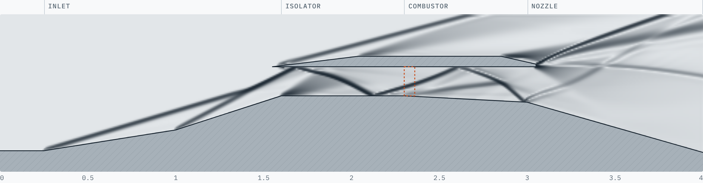
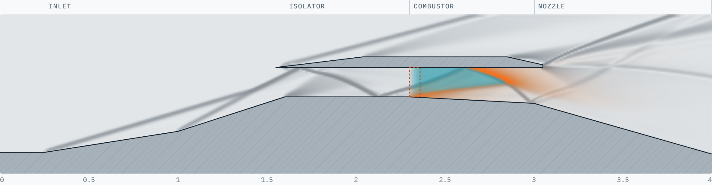

# Scramjet Flow Lab

An interactive 2D fluid simulation of a **scramjet** (supersonic combustion ramjet) that runs in your browser. Air comes in at hypersonic speed, gets squeezed by shock waves, burns hydrogen while it is still supersonic, and expands out of the nozzle to make thrust.

**▶ Live demo:** https://farvanyoshi.github.io/scramjet-sim/





## What a scramjet is

A jet engine needs slow, high-pressure air to burn fuel in. A normal jet uses spinning compressor blades for that. A scramjet has **no moving parts**. It flies so fast (Mach 5+) that just bending the air with angled walls compresses and heats it.

| Section | What happens |
|---|---|
| **Inlet** | Ramps turn the flow. Each turn makes an *oblique shock*: pressure and temperature jump, speed drops (Mach 6 → ~3.3 here). |
| **Isolator** | Straight duct. Shocks bounce between the walls. It shields the inlet from pressure spikes in the combustor. |
| **Combustor** | Hydrogen is injected. If the air is hot enough (~850 K), it ignites on its own. The flow stays **supersonic** while it burns: that is the "s" in scramjet. |
| **Nozzle** | The floor drops away so the hot, high-pressure gas expands and speeds up. Its pressure pushing on the sloped wall is the thrust. |

## Using it

- **Flight Mach number** (3–10): how fast the vehicle flies.
- **Fuel φ** (equivalence ratio): 0 = no fuel, 1 = exactly enough H₂ to burn all the oxygen.
- **View**: Mach number, temperature, pressure, schlieren (shows shocks), or fuel & flame.
- Hover over the flow to read local Mach, temperature, pressure and speed.

Things to try:
1. **Mach 4**: the air only reaches ~640 K, the hydrogen never ignites, and the engine makes only drag.
2. **Fuel off**: net force is negative (drag).
3. **Mach 6, φ = 0.6** (default): supersonic combustion, positive thrust.
4. **φ → 1.5**: more thrust, but the combustor exit approaches Mach 1 (thermal choking).
5. **Mach 10**: everything ignites, but the heat added is small next to the air's kinetic energy, so thrust is weak.

## Running locally

The page uses ES modules and a Web Worker, so it needs to be served over HTTP (opening `index.html` directly as a file will not work):

```bash
git clone https://github.com/farvanyoshi/scramjet-sim.git
cd scramjet-sim
python3 -m http.server 8000
```

Then open http://localhost:8000.

Headless solver check with Node 18+ (prints the readouts as the flow develops):

```bash
node test/run.js 6 0.6 3000 320   # mach, phi, steps, grid width
```

## How it works

### Physics
2D compressible **Euler equations** (inviscid) plus one extra equation for the fuel:

```
∂U/∂t + ∂F/∂x + ∂G/∂y = S,     U = [ρ, ρu, ρv, E, ρY]
```

- Ideal gas, γ = 1.4. Freestream at 30 km altitude: 226.5 K, 1.20 kPa, 301.7 m/s speed of sound.
- `Y` is the unburnt hydrogen mass fraction. Fuel is added in a thin band at the start of the combustor.
- Burn rate: `ω = A · ρ · Y · s(T)`, where `s(T)` is a smooth switch that turns on around 850 K and off near 3,000 K (dissociation limit). Burned fuel releases an *effective* 50 MJ/kg into the energy equation. The real value for H₂ is 120 MJ/kg, but with constant γ and no dissociation that would give unrealistic ~7,000 K flames.

### Numerics (`src/solver.js`)
- Finite volume on a uniform Cartesian grid.
- MUSCL reconstruction of primitive variables with a van Leer limiter (2nd order in space).
- HLLC approximate Riemann solver.
- 2-stage SSP Runge–Kutta (2nd order in time), CFL 0.4.
- Walls: ghost-cell immersed boundary. Solid cells next to the flow copy the state at their mirror-image point across the real wall line, with the normal velocity flipped. This makes the slanted ramps behave as smooth slip walls instead of staircases.
- Boundaries: supersonic inflow (left), zero-gradient outflow (right, top).
- Thrust is the x-component of the pressure force (minus freestream pressure) on every wall face.

### Files
```
index.html        page layout
style.css         styles (light and dark themes)
src/geometry.js   engine shape (ramps, cowl, nozzle)
src/solver.js     Euler + combustion solver
src/worker.js     runs the solver in a Web Worker
src/render.js     colormaps, schlieren, probe
src/main.js       UI and drawing loop
test/run.js       headless Node test
```

## Limitations

This is a teaching tool, not a design code. Missing physics: viscosity and boundary layers (so no shock-induced separation or skin friction), turbulence, real finite-rate chemistry, fuel–air mixing, variable specific heats, and 3D effects. Absolute thrust numbers are rough. The trends (ignition limit, shock structure, thermal choking) are the point.

## License

MIT
